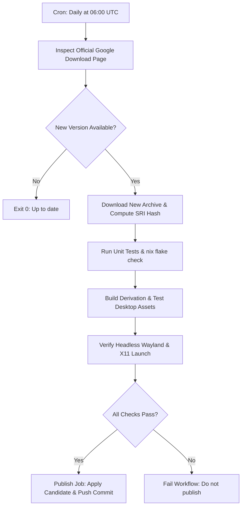

# Google Antigravity Hub for NixOS

[](https://github.com/B-Shinchan/antigravity-hub-nixos/actions/workflows/ci.yml)
[](https://github.com/B-Shinchan/antigravity-hub-nixos/actions/workflows/update.yml)
[](LICENSE)
[](flake.nix)

Official vendor binary packaging of **Google Antigravity 2.0** (Agent Hub / Mission Control) for NixOS, featuring automated 24-hour upstream updates, native Wayland/X11 desktop integration, and GPU-accelerated FHS sandboxing.

---

## What is Google Antigravity Hub?

Google Antigravity 2.0 is an agentic AI coding platform and mission control center. It allows developers to deploy, inspect, and supervise autonomous agent workflows across local codebases.

> [!NOTE]
> **Antigravity Hub vs. Antigravity IDE**:
> - **Antigravity Hub** (this repository): Google's standalone agent mission control application (`antigravity-hub`). It provides the agent orchestration UI, task manager, artifact viewers, and background language server.
> - **Antigravity IDE**: Google's agent-first code editor built on VS Code (`antigravity-ide`). If you are looking for the editor, see [B-Shinchan/antigravity-nixos](https://github.com/B-Shinchan/antigravity-nixos).
>
> Both applications can be installed and run concurrently with zero conflict in desktop docks, window switchers, or user data directories.

---

## Features

- **Official Upstream Binaries**: Packaged directly from Google's canonical distribution at `https://antigravity.google/download`.
- **Automated Daily Updates**: A scheduled GitHub Actions workflow checks for new Google releases every 24 hours, validates SHA-256 SRI hashes, runs automated tests, and updates the package without manual intervention.
- **Flawless Desktop Integration**: Standard Freedesktop desktop entries, complete hicolor icon sets (16×16 to 1024×1024), and proper `StartupWMClass` matching.
- **Hardware Acceleration**: GPU-accelerated rendering under Wayland and X11 with Vulkan, VA-API, and OpenGL support.
- **Isolated User State**: Stores data in `~/.config/Antigravity` and `~/.gemini/antigravity`, completely isolated from other applications.

---

## Quick Start

Try Antigravity Hub without installing:

```bash
nix run github:B-Shinchan/antigravity-hub-nixos
```

---

## Installation

### 1. In NixOS Configuration (`flake.nix`)

Add the repository to your flake inputs:

```nix
{
  inputs = {
    nixpkgs.url = "github:NixOS/nixpkgs/nixos-unstable";
    antigravity-hub.url = "github:B-Shinchan/antigravity-hub-nixos";
  };

  outputs = { self, nixpkgs, antigravity-hub, ... }: {
    nixosConfigurations.yourhostname = nixpkgs.lib.nixosSystem {
      system = "x86_64-linux";
      modules = [
        ({ pkgs, ... }: {
          environment.systemPackages = [
            antigravity-hub.packages.${pkgs.stdenv.hostPlatform.system}.default
          ];

          # Ensure 3D graphics acceleration is enabled
          hardware.graphics.enable = true;
        })
      ];
    };
  };
}
```

### 2. With Home Manager

```nix
{ inputs, pkgs, ... }: {
  home.packages = [
    inputs.antigravity-hub.packages.${pkgs.stdenv.hostPlatform.system}.default
  ];
}
```

### 3. Using the Flake Overlay

```nix
{
  nixpkgs.overlays = [
    inputs.antigravity-hub.overlays.default
  ];
}
```

Then reference `pkgs.antigravity-hub` anywhere in your system or user configuration.

### 4. Imperative Installation

```bash
nix profile install github:B-Shinchan/antigravity-hub-nixos
```

---

## Desktop Environment & Window Identification

Under Wayland compositors (such as GNOME, KDE, Niri, Sway, and Hyprland), Electron assigns the window `app_id` as `"antigravity"`.

To guarantee that your taskbar, dock, and window switcher immediately associate the running window with the correct icon and title, this package provides:
- Primary launcher: `/share/applications/antigravity-hub.desktop` (`Exec=antigravity-hub`)
- Compositor alias: `/share/applications/antigravity.desktop` (symlinked)
- Standardized `StartupWMClass=antigravity`

Both Antigravity Hub and Antigravity IDE can run side-by-side with independent dock icons and independent running-app indicators.

---

## Automated Update Architecture

This repository uses a two-phase GitHub Actions workflow that runs every 24 hours:



Updates are never committed unless:
1. The downloaded tarball is authenticated against Google's CDN.
2. The package compiles and all lint/style checks (`ruff`, `nixfmt`) pass.
3. Headless integration tests verify launcher executability and desktop file validity.

---

## Verification & Local Testing

You can run the full test suite locally:

```bash
# Verify flake checks, desktop validation, and unit tests
nix flake check --print-build-logs

# Run a dry-run upstream check
python3 scripts/update.py --dry-run

# Run updater test suite
python3 -m unittest discover -s tests -v
```

---

## Companion Applications

This package is part of a suite of official vendor AI applications packaged for NixOS:

| Application | Command | Repository |
| :--- | :--- | :--- |
| **ChatGPT Desktop** | `chatgpt` | [chatgpt-desktop-nixos](https://github.com/B-Shinchan/chatgpt-desktop-nixos) |
| **Claude Desktop** | `claude-desktop` | [claude-desktop-nixos](https://github.com/B-Shinchan/claude-desktop-nixos) |
| **Google Antigravity IDE** | `antigravity-ide` | [antigravity-nixos](https://github.com/B-Shinchan/antigravity-nixos) |
| **Google Antigravity Hub** | `antigravity-hub` | [antigravity-hub-nixos](https://github.com/B-Shinchan/antigravity-hub-nixos) |

---

## Contributing

Contributions, bug reports, and suggestions are welcome! Please read [CONTRIBUTING.md](CONTRIBUTING.md) before opening a pull request.

---

## Security

Please report any security concerns privately as outlined in [SECURITY.md](SECURITY.md).

---

## License & Trademarks

- **Packaging & Code**: Licensed under the [MIT License](LICENSE).
- **Upstream Application**: Google Antigravity is a proprietary application provided by Google LLC under its own Terms of Service. This repository is an independent community packaging project and is not affiliated with or endorsed by Google LLC.
